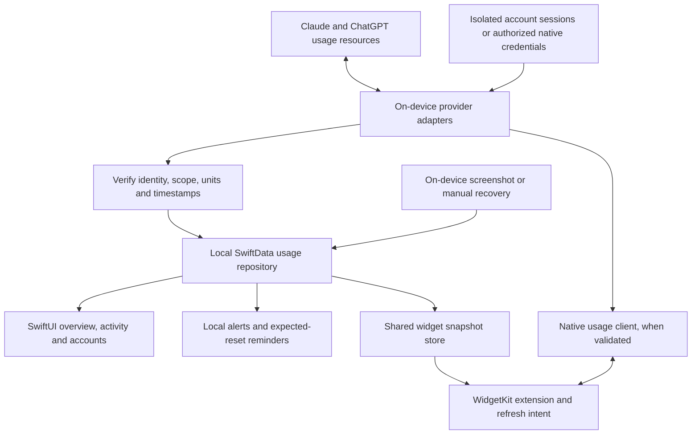

# Headroom — standalone iOS design

> Direct widget refresh update (October 20, 2026, version 0.6.0): Scheduled timelines and the Home Screen Refresh button fetch native provider usage directly using shared Keychain credentials. The owner confirmed real-account refresh without leaving the Home Screen. Automatic delivery remains controlled by iOS; see [verification](native-build.md).

> Widget scope update (October 20, 2026, version 0.5.5): Only the working Live overview widget remains, in medium/large sizes, with no account configuration. Older allowance widgets and their gallery controls were removed at the owner’s request.

> Implementation update (October 20, 2026, version 0.5): Real Claude and ChatGPT/Codex usage retrieval was confirmed by the owner. Native per-account OAuth credentials now support opportunistic Background App Refresh with no app-imposed scheduling delay, plus a Home Screen widget Refresh intent. Foreground checks run every minute; per-account cooldowns and provider backoff remain enforced. iOS controls automatic delivery, so no fixed background frequency is promised. Website-only connections require foreground collection. Exact all-product token totals remain unavailable. See native-build.md for the distinction between automated verification and device observations.

Status: native SwiftUI app in `Headroom.xcodeproj`, plus a WidgetKit target, with real Claude and ChatGPT/Codex connections, manual readings, local history, and shared widget collection. The app starts without demo data. Codable account data and an App Group snapshot provide local persistence. SwiftData remains a future storage option rather than a current dependency. The sections below retain the original design scope; the dated updates and widget specification describe the shipped widget choices.

## Required operating model

Headroom runs independently on the iPhone. Authentication, direct quota reads, storage, history, and notifications all belong to the iOS app. No desktop helper, CLI service, remote collector, required cloud backend, or device-pairing flow is part of the product.

The user confirmed personal use, multiple Claude/ChatGPT accounts, and coverage of both chat and coding usage. A provider's shared server quota can reflect those surfaces even when per-surface token totals are unavailable.

Automatic direct quota sync is the primary objective. Manual entry and screenshot capture are secondary recovery methods. A manual-only implementation does not count as completion of automatic tracking.

## Product objective

Answer three questions quickly:

1. What allowance remains on each account?
2. When do its relevant limits reset?
3. What does each reading cover, and how recently was it observed?

Include token history only when a source accessible from the phone returns actual counts with known coverage. Do not invent desktop telemetry or infer tokens from quota percentages.

## First release

- Several independent accounts for Claude and ChatGPT, each with verified identity where available, a user alias, plan metadata, and workspace scopes.
- Direct on-device account connection and foreground sync, gated by successful provider validation.
- Per-account quota windows, percentages, reset timestamps, original observation time, and connection health.
- Local quota observation history from the point of collection onward.
- Provider-reported tokens/credits only when available through the validated connection.
- Local optional threshold alerts and expected-reset reminders.
- Manual recovery form and a planned on-device screenshot/OCR flow.
- Local persistence and aggregate export. No hosted service is required.
- First-release Home Screen and Lock Screen widgets for quick checks without opening Headroom, with per-widget account/window selection and visible freshness.

Later: an optional iOS Safari capture extension if needed, more providers, and API usage as a separate account type.

## Navigation and screens

Use SwiftUI `TabView` with **Overview**, **Activity**, and **Accounts**. Settings is in the navigation bar. Use `NavigationStack` for detail and a sheet for account connection or recovery input.

### Overview

Show one card per account, with All/Claude/ChatGPT filters. A compact provider-grouped list is an alternative layout.

Every card includes provider + alias, plan/workspace, known quota rows, reset information, collection source, age, and connection problems. Sources include “Web sync · 2m ago,” “Provider API · 5m ago,” and “Manual · 4h ago.” Do not label a conceptual connection as working in the real product.

Use **percentage used** consistently in bars. Remaining percentage can appear as secondary text. Do not average percentages across accounts. Show multiple windows independently, including model/product quotas when returned. A shared pool is stored once even if chat and code both consume it.

Short-window and weekly allowances each have a visible progress bar, reset, and observation age. The weekly row remains visible when the short-window reading is missing. Below them, show every available model/model-group limit with its provider label, actual window name, separate bar, reset, age, source, and reported counts when present. Model limits may overlap the account allowance; never sum them. Model names or plan names alone do not establish that a separate limit exists.

Unknown windows say “Not available.” Stale values retain their age. After an expected reset, show “Awaiting update” until a fresh reading confirms the new state.

### Account detail

Header: provider, alias, plan, workspace, connection health.

- Allowance: every known window with its own observation time/source.
- Coverage: provider-defined shared pool or named product; include known exclusions.
- Token activity: actual provider-reported counts where available; otherwise unavailable.
- Connection: on-device sign-in state, last successful read, capabilities, and repair action.
- Actions: sync, view usage page, reconnect, recovery input, and alert rules.

A partial update must not make untouched windows look fresh. A successful identity request alone must not refresh the quota observation timestamp.

### Activity

Default to **Quota history**, with an account selector. Plot captured readings inside identified windows, with time/percentage axes. Break traces at resets, missing periods, source changes, and plan changes. History is a series of observations, not an exact token/message ledger.

Provide a separate **Tokens** view only to show real provider counts or a clear unavailable state. Each total has its source, reporting period/timezone, scope, and coverage. Do not promise access to another device's local sessions.

The concept uses a few observations from one quota window. Sample token totals have been removed because no direct on-device token source has been validated.

### Accounts and connection flow

Group accounts by provider. Each has its own profile, identity/workspace binding, session, capabilities, and health. Several accounts can remain connected concurrently without changing another app's active login.

1. Choose provider and optional alias.
2. Continue to the actual provider sign-in using the validated flow. The tracker does not collect provider passwords in a native form.
3. Confirm returned identity and select workspace if applicable.
4. Read actual usage and show a capability preview: windows, token availability, source support level, and background eligibility.
5. Save the verified connection and first observation.

If sign-in succeeds but quota access fails, save “Connected · usage unavailable,” not a successful sync. Label unverified profiles. Email/alias is not the account primary key.

Reconnect affects one account. Removal deletes its local session/profile and history after a concrete confirmation; revoke app-owned tokens where supported. Other accounts remain intact.

### Recovery input

Manual entry: account, workspace/window, percentage, optional reset, and actual observation time; preview before saving.

Screenshot flow: choose/share a usage screenshot, run on-device Vision OCR, assign the account, and confirm extracted values. An image is untrusted input. Never silently merge it into the selected account or accept relative reset times without capture-time context.

### Settings and widgets

Settings: refresh preferences, per-account alerts, retention, export, and delete data. No pairing or collector-device settings.

Widgets are a core first-release feature: small for one account, medium/large for selected accounts, and accessory widgets on the Lock Screen. Each instance is configured independently through iOS widget editing. The app can preview designs and explain setup but cannot silently place a widget on the user's Home Screen.

Widgets render the latest shared snapshot without launching Headroom. A validated native provider adapter can refresh from the widget extension; WebKit-only sources remain last-synced displays until the app collects a new reading. A Home Screen refresh button uses an App Intent where that native path exists, without deliberately opening the main app. Authentication recovery opens the app only when the user chooses it.

Each reading shows account/window, measured usage, reset if known, and observation age. Local timelines mark data as stale or reset-awaiting-confirmation without inventing a new measurement. Widgets display saved labels and usage directly, as requested by the owner; version 0.5.2 removes app-imposed hiding. See [widget specification](widgets.md) for layouts, privacy, refresh behavior, and acceptance tests.

## Visual and accessibility language

Native SF typography, grouped surfaces, 16–20 pt spacing, SF Symbols, and teal actions in light/dark appearances. Amber/red indicate measured warnings/errors, with text equivalents. Percentages and times use tabular numerals.

At least 44 pt effective touch targets, Dynamic Type with stacked rows, VoiceOver including account/window/used/reset/age, and Reduce Motion support. Do not rely on color for provider identity or stale state.

The review concept shows two layouts with illustrative on-device sources. Sign-in/sync actions are simulations; they do not access a real provider.

## Architecture

Proposed baseline: iOS 17+ for SwiftUI, Observation, SwiftData, and identified persistent WebKit stores. Confirm the owner's device before implementation.



| Component | Responsibility |
| --- | --- |
| SwiftUI views and observable models | Presentation, navigation, input, accessibility |
| `AccountRegistry` | Stable IDs, aliases, verified subjects, workspace bindings |
| `AccountSessionStore` | Isolated WebKit profiles and/or app-owned Keychain references |
| `ProviderAdapter` | Connect, discover capabilities, read usage, renew authorized sessions, typed errors |
| `UsageRepository` | Scoped snapshots, optional token data, provenance, history |
| `RefreshCoordinator` actor | Concurrency limits, identity binding, deduplication, backoff |
| `ScreenshotImporter` | Local Vision parsing and confirmed recovery snapshots |
| `NotificationPlanner` | Deduplicated threshold observations and reset reminders |
| `WidgetSnapshotStore` | Atomic App Group snapshots, account generations, per-reading timestamps, tombstones |
| `HeadroomWidgets` | WidgetKit timelines, independent configurations, conditional native refresh, direct usage views |

### Direct provider adapters

Report capabilities individually: windows, token summary, historical buckets, credits/spend, identity, native background eligibility, and interactive renewal. Mark support as documented, experimental web, or manual. A working login does not imply a working usage adapter.

Prefer documented authorization/reporting when available for this app. Otherwise investigate the web session and usage resources directly on iOS. Desktop open-source implementations are evidence about network protocols only; do not import desktop credential discovery or CLI components.

For WebKit collection, requests remain in the matching profile's same-origin authenticated context. Return bounded normalized data to native code. Handle redirects, unexpected HTML, scopes, and schemas explicitly. An HTTP 200 login page is not usage JSON.

A native `URLSession` path is a separately validated capability requiring compatible credentials, correct audience/scope, and isolated storage. A website cookie is not an OAuth token, and an inference token does not necessarily grant quota access.

Adapters make no inference requests to test usage and do not change plans, credits, active provider accounts, or quota resets.

### Multi-account isolation

- Each connection has its own UUID and persistent `WKWebsiteDataStore(forIdentifier:)` when using a web session.
- Never share the default web profile. This app cannot inherit the official apps' sessions.
- Use supported OAuth with PKCE/state/nonce and verified callbacks where available. Validate native/public-client eligibility and renewal rather than borrowing a first-party client ID.
- OAuth secrets live in Keychain; WebKit owns web-session data. Usage records contain references, never tokens/cookies.
- If native HTTP uses cookies, isolate each account's session/store and avoid global shared storage. Validate this route separately.
- Reverify account/workspace before accepting usage, including after login/renewal.
- Capture connection, scope, and generation at refresh start. Reject late results after removal/reconnect/identity changes.

### Web/native boundary

Allow expected HTTPS origins/navigation only. Accept collection messages from the correct main frame/security origin and account generation. Keep the script bridge narrow, with bounded response sizes and types. Treat page content as data, not instructions.

Login remains interactive. Do not intercept passwords, spoof a trusted client, or bypass challenges. If a required flow is blocked in WebKit, report it and evaluate the iPhone-only capture alternative rather than claiming automatic collection works.

### Core data model

| Entity | Important fields |
| --- | --- |
| `Account` | UUID, provider, alias, verified subject, plan + provenance |
| `UsageScope` | Account, workspace, product/surface, shared pool if known |
| `Connection` | Scope, web-profile ID or credential reference, generation, capabilities, state |
| `UsageSnapshot` | UUID, connection/scope, observed/received times, source/schema, coverage |
| `QuotaWindow` | Provider key, duration if supplied, used fraction or typed counts, reset, state |
| `ModelQuotaLimit` | Stable key within an account, model/group name, actual window label, independent reading, optional typed used/limit counts |
| `TokenBucket` | Scope/source/period, actual counts/components, semantics, coverage, dedupe ID |
| `AlertRule` / `AlertEvent` | Scope/pool/window, thresholds, observed period, event key, delivery state |

Identity is provider + stable subject, with workspace as a scope. Manual records remain unverified until linked. Shared pools are stored/alerted once.

Missing is not zero/unlimited. Resets come from the source. Preserve provider period/timezone semantics; never sum overlapping token aggregates or incompatible cache components. Each window retains its own provenance.

The native prototype stores optional model limits on each account and model-scoped observations in history. Decoding older accounts defaults model limits to an empty list and preserves existing windows/history. A model update must not freshen the account-wide windows or another model's reading. Count-based limits may derive a used percentage from valid reported counts; percentages never derive token/message totals.

### Refresh and background execution

- Render cached readings immediately, then sync eligible accounts directly.
- Pull-to-refresh is the primary explicit action. Foreground polling checks every minute, subject to account cooldowns and provider backoff.
- Refresh accounts independently with a small concurrency limit. One expired session does not block others.
- Native background refresh is opportunistic and enabled only for validated native HTTP adapters with appropriately accessible protected credentials.
- WebKit-only adapters refresh in the foreground. A suspended web view is not a guaranteed collector.
- Manual/image snapshots do not poll. Their age stays visible.
- Reconnect/transport success does not change an old observation's timestamp.
- Explicit widget refresh and scheduled timeline delivery use the same native HTTP clients directly, with protected credentials in the existing signed App Group’s Keychain. Cross-process locks serialize reads/renewal, shared metadata enforces cooldowns, and atomic snapshot merges preserve newer readings and reject deleted/reconnected identities. WebKit-only connections cannot take this path.

Unauthorized → reconnect; challenge → interactive provider page; rate limit → retry-after/backoff; changed schema → source-changed state; offline → last-known reading. Missing fields stay unknown; passed resets await confirmation.

### Alerts

Optional thresholds: 80% and 95% used per pool/window. Use fresh observations and deduplicate per rule/account/window/reset period. A first reading already high is labeled a high current observation, not an observed crossing.

Expected-reset reminders use the latest returned timestamp and are rescheduled/cancelled on changes or removal. “Reset expected” does not prove fresh capacity. Immediate alerts while iOS suspends the app are not promised.

## Proposed project organization

```text
Headroom/
  App/
  Features/Overview/
  Features/Activity/
  Features/Accounts/
  Features/AccountDetail/
  Features/Settings/
  Domain/Identity/
  Domain/Usage/
  Data/Persistence/
  Providers/Claude/
  Providers/OpenAI/
  Services/AccountSessions/
  Services/Credentials/
  Services/Refresh/
  Services/ScreenshotImport/
  Services/Notifications/
  DesignSystem/
HeadroomShareExtension/            # optional screenshot intake
HeadroomWidgets/                   # required first-release WidgetKit target
HeadroomShared/                    # native client, value models, widget snapshots
HeadroomTests/
```

One native app is sufficient. Optional iOS extensions share schema code without introducing an external service.

## Validation and implementation order

1. Prove on-device sign-in/direct quota access for one account per provider.
2. Prove two-account persistence/isolation per provider, renewal, and workspace binding.
3. Build native screens/local history against verified redacted fixtures.
4. Connect real adapters; test restarts, partial failures, background eligibility, and no mixed-account values.
5. Ship Home Screen and Lock Screen widgets, native refresh where validated, alerts, recovery input, and accessibility polish. Widget glanceability and independent freshness are separate acceptance checks.

The initial gate is roughly 2–4 developer days as a planning estimate. Revise implementation estimates after observing actual access; do not carry forward the earlier desktop-collector schedule.

Checks: simultaneous refresh; stale results after reconnect/removal; identical emails in different scopes; login-page-as-JSON; absent/invalid fields; expiry/challenges/rate limits; timestamp preservation; reset/DST handling; alert deduplication; Dynamic Type; VoiceOver; 320 pt layouts.

If automatic access fails, report the affected provider/scope before replacing the requirement with manual tracking. The standalone constraint stays in force.
